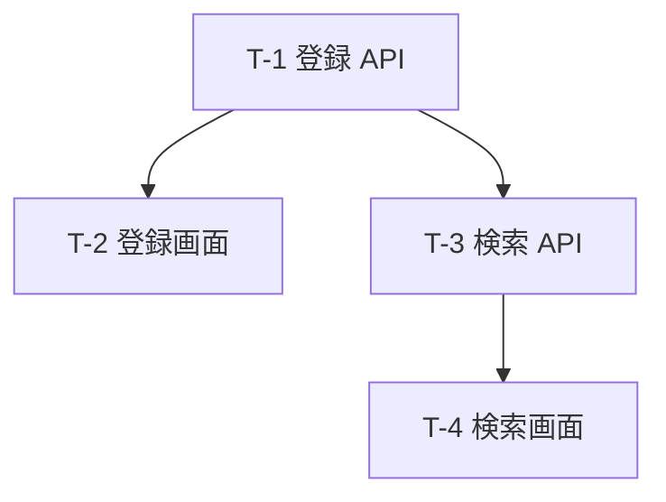

# 実装計画：本の登録

| 項目 | 内容 |
|---|---|
| 機能 ID | F01 |
| 計画の ID | F01（初回の開発の計画。作業が終わったら凍結する記録） |
| 上流の要件 | [requirements.md](requirements.md) |
| レビュー | テックリード／チーム（技術の設計と同じ PR） |

## 3. タスク分解（順序・依存）

1 タスク＝PR 1 つ。タスクごとに親のストーリーを 1 つ書く（デモで足した列）。

| 番号 | タスク | 親ストーリー | 対応要件・設計 | 先行タスク（依存） |
|---|---|---|---|---|
| T-1 | 本のデータと登録 API を作る | US-1 | FR-1 | なし |
| T-2 | 本の登録画面を作る | US-1 | FR-1 | T-1 |
| T-3 | 本を探す API を作る | US-2 | FR-2 | T-1 |
| T-4 | 本を探す画面を作る | US-2 | FR-2 | T-3 |

## 4. 受入基準（タスクの合否）

- **AC-1**（T-1）：題名・著者・ISBN を送ると、本が保存され、一覧の API で返る
- **AC-2**（T-2）：画面で入れた本が一覧に出る
- **AC-3**（T-3・T-4）：題名の一部で探すと、合う本だけが返る
