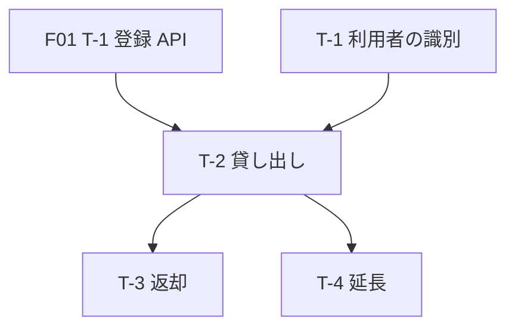

# 実装計画：貸し出し

| 項目 | 内容 |
|---|---|
| 機能 ID | F02 |
| 計画の ID | F02（初回の開発の計画。作業が終わったら凍結する記録） |
| 上流の要件 | [requirements.md](requirements.md) |
| レビュー | テックリード／チーム（技術の設計と同じ PR） |

## イネーブラーストーリー（デモでの置き場所）

ユーザーから見えない、ストーリーをまたぐ作業。置き場所は未決のため、デモでは実装計画に書く。

| 番号 | 題 | 使う側のストーリー |
|---|---|---|
| EN-1 | 利用者を見分ける仕組みを用意する | US-1, US-2, US-3 |

## 3. タスク分解（順序・依存）

1 タスク＝PR 1 つ。タスクごとに親のストーリーを 1 つ書く（デモで足した列）。先行タスクがほかの機能のときは、計画の ID を付けて書く。

| 番号 | タスク | 親ストーリー | 対応要件・設計 | 先行タスク（依存） |
|---|---|---|---|---|
| T-1 | 利用者を見分ける仕組みを作る | EN-1 | NFR-1 | なし |
| T-2 | 貸し出しの API と画面を作る | US-1 | FR-1 | T-1, F01 T-1 |
| T-3 | 返却の API と画面を作る | US-2 | FR-2 | T-2 |
| T-4 | 延長の API と画面を作る | US-3 | FR-3 | T-2 |

## 4. 受入基準（タスクの合否）

- **AC-1**（T-1）：利用者の ID がない要求は断られる
- **AC-2**（T-2）：借りると本が貸し出し中になり、返す期限が返る
- **AC-3**（T-3）：返すと本が貸し出せる状態に戻る
- **AC-4**（T-4）：期限の前に延長すると、期限が 2 週間延びる
